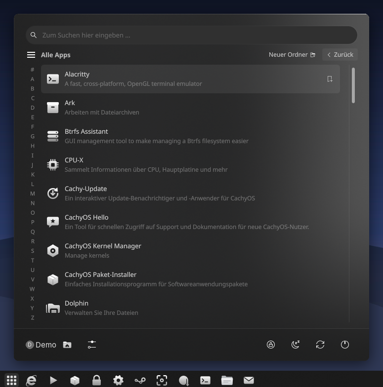

# Neo11Menu

Ein Startmenü im Stil von Windows 11 für KDE Plasma 6 – eine eigene, deutsche Version auf Basis von [Menu 11 Next](https://github.com/Eisteed/menu-11-next) von Eisteed.

| Startseite | Alle Apps |
|---|---|
|  |  |

<sub>Echte Screenshots unter CachyOS mit Plasma 6, [Neo11 Taskleiste](https://github.com/RembrandtZ4/Neo11-Taskbar) und [Neo11-Symbolen](https://github.com/RembrandtZ4/Neo11-Icons)</sub>

## Funktionen

- Eigener Startbutton (3×3 Kacheln) mit Hover-Effekt im Stil von Windows 11
- Angeheftete Apps, alle Apps als Liste, Raster oder nach Kategorien
- Ordner per Drag & Drop
- Zuletzt verwendete Dokumente und Apps
- Suche mit Rechner (`/calc 3*4`) und Shell-Befehlen (`> befehl`, optional)
- Schnellaktionen (Bildschirmfoto, Sperren, Terminal …) und Energie-Schaltflächen
- Optionales Wetter-Widget (Daten von Open-Meteo)
- „An Taskleiste anheften“ für die [Neo11 Taskleiste](https://github.com/RembrandtZ4/Neo11-Taskbar)
- Dunkle Infofenster und Akzentfarbe Neo11-Silber (umschaltbar auf die Systemfarbe)
- Komplett auf Deutsch

## Voraussetzungen

KDE Plasma 6.5 oder neuer.

## Installation

```bash
git clone https://github.com/RembrandtZ4/Neo11Menu.git
cd Neo11Menu
./install.sh
```

Danach: Rechtsklick auf den bisherigen Startknopf ▸ **„Alternativen anzeigen …“** ▸ **Neo11Menu**.

## Aktualisieren

```bash
cd Neo11Menu
git pull
./install.sh
```

Das Skript erkennt eine vorhandene Installation, aktualisiert sie und startet Plasma neu.

## Entfernen

```bash
kpackagetool6 -t Plasma/Applet -r de.rembrandtz4.neo11menu
rm ~/.local/share/icons/hicolor/scalable/apps/neo11menu.svg
```

## Lizenz

GPL-2.0 oder neuer (siehe `LICENSE`), wie das Original.
Basiert auf Menu 11 Next von Eisteed, das wiederum auf „menu 11 plasma6“ von adhec und Code von Eike Hein (KDE) aufbaut.
