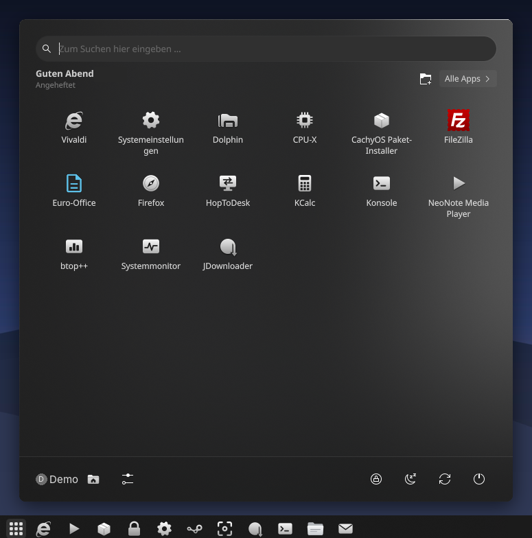

# Neo11Menu

A Windows 11 style start menu for KDE Plasma 6 – a custom German version based on [Menu 11 Next](https://github.com/Eisteed/menu-11-next) by Eisteed.

| Start page | All apps |
|---|---|
|  |  |

<sub>Real screenshots on CachyOS with Plasma 6, [Neo11 Taskbar](https://github.com/RembrandtZ4/Neo11-Taskbar) and [Neo11 icons](https://github.com/RembrandtZ4/Neo11-Icons) / Echte Screenshots</sub>

## Features

- Own start button (3×3 tiles) with a Windows 11 style hover effect
- Pinned apps; all apps as list, grid or by category
- Folders via drag & drop
- Recently used documents and apps
- Search with calculator (`/calc 3*4`) and shell commands (`> command`, optional)
- Quick actions (screenshot, lock, terminal …) and power buttons
- Optional weather widget (data from Open-Meteo)
- “Pin to taskbar” for the [Neo11 Taskbar](https://github.com/RembrandtZ4/Neo11-Taskbar)
- Dark tooltips and Neo11 silver accent color (switchable to the system accent color)
- Smooth slide-up animation when opening (can be turned off)
- User interface in German

## Requirements

KDE Plasma 6.5 or newer.

## Install

```bash
git clone https://github.com/RembrandtZ4/Neo11Menu.git
cd Neo11Menu
./install.sh
```

Then: right-click your current start button ▸ **“Show Alternatives …”** ▸ **Neo11Menu**.

## Update

```bash
cd Neo11Menu
git pull
./install.sh
```

The script detects an existing installation, updates it and restarts Plasma.

## Remove

```bash
kpackagetool6 -t Plasma/Applet -r de.rembrandtz4.neo11menu
rm ~/.local/share/icons/hicolor/scalable/apps/neo11menu.svg
```

## License

GPL-2.0 or later (see `LICENSE`), like the original.
Based on Menu 11 Next by Eisteed, which builds on “menu 11 plasma6” by adhec and code by Eike Hein (KDE).

---

# Neo11Menu (Deutsch)

Ein Startmenü im Stil von Windows 11 für KDE Plasma 6 – eine eigene, deutsche Version auf Basis von [Menu 11 Next](https://github.com/Eisteed/menu-11-next) von Eisteed. Screenshots siehe oben.

## Funktionen

- Eigener Startbutton (3×3 Kacheln) mit Hover-Effekt im Stil von Windows 11
- Angeheftete Apps, alle Apps als Liste, Raster oder nach Kategorien
- Ordner per Drag & Drop
- Zuletzt verwendete Dokumente und Apps
- Suche mit Rechner (`/calc 3*4`) und Shell-Befehlen (`> befehl`, optional)
- Schnellaktionen (Bildschirmfoto, Sperren, Terminal …) und Energie-Schaltflächen
- Optionales Wetter-Widget (Daten von Open-Meteo)
- „An Taskleiste anheften“ für die [Neo11 Taskleiste](https://github.com/RembrandtZ4/Neo11-Taskbar)
- Dunkle Infofenster und Akzentfarbe Neo11-Silber (umschaltbar auf die Systemfarbe)
- Sanftes Hochgleiten beim Öffnen (abschaltbar)
- Komplett auf Deutsch

## Voraussetzungen

KDE Plasma 6.5 oder neuer.

## Installation

```bash
git clone https://github.com/RembrandtZ4/Neo11Menu.git
cd Neo11Menu
./install.sh
```

Danach: Rechtsklick auf den bisherigen Startknopf ▸ **„Alternativen anzeigen …“** ▸ **Neo11Menu**.

## Aktualisieren

```bash
cd Neo11Menu
git pull
./install.sh
```

Das Skript erkennt eine vorhandene Installation, aktualisiert sie und startet Plasma neu.

## Entfernen

```bash
kpackagetool6 -t Plasma/Applet -r de.rembrandtz4.neo11menu
rm ~/.local/share/icons/hicolor/scalable/apps/neo11menu.svg
```

## Lizenz

GPL-2.0 oder neuer (siehe `LICENSE`), wie das Original.
Basiert auf Menu 11 Next von Eisteed, das wiederum auf „menu 11 plasma6“ von adhec und Code von Eike Hein (KDE) aufbaut.
